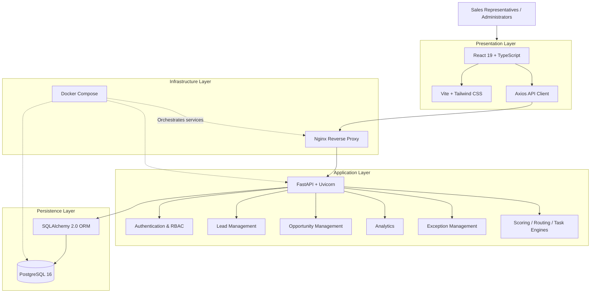
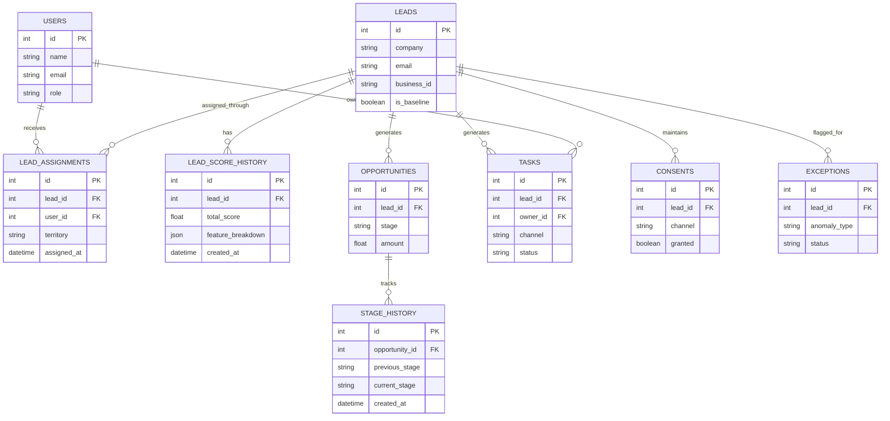
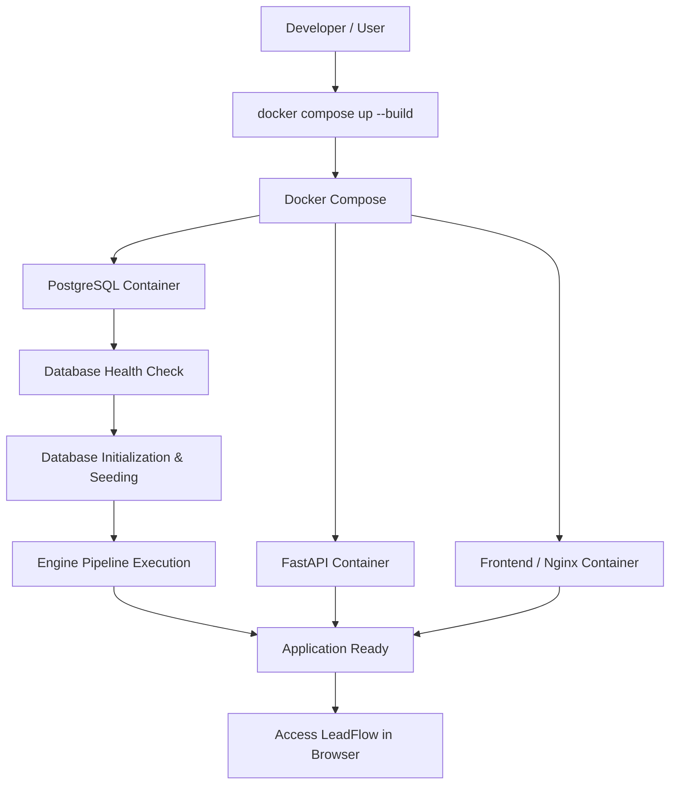

# LeadFlow — System Architecture & Engineering Design

This document details the architectural blueprint, component interactions, data flows, and technical design powering **LeadFlow: Lead Intelligence & Opportunity Management Platform**.

---

## 1. Business Problem & System Objectives

Traditional B2B revenue organizations struggle with fragmented lead management across marketing, sales, and data operations.

### Key Problems

- **Black-Box Prioritization:** Sales teams cannot understand why a lead receives a particular score. Lack of explainability leads to inconsistent follow-ups and gut-feel decisions.
- **Manual Assignment Bottlenecks:** Leads remain unassigned for hours or days. Territory rules, product expertise, and sales representative workload capacities are often ignored.
- **Consent & Compliance Violations:** Teams may contact prospects who have opted out. Generic follow-up tasks fail to specify which communication channels are legally permitted.
- **Data Corruption & Silently Fixed Anomalies:** Duplicate pipeline records inflate revenue forecasts. Data quality failures are often silently overwritten instead of being surfaced for human review.

### System Objectives

1. **Explainability:** Every lead score provides an itemized breakdown of Fit (30), Intent (35), Engagement (25), and Recency (10) feature contributions.
2. **Determinism:** The entire 20,000-lead dataset is reproducibly generated using the fixed pseudo-random seed `20261022`.
3. **Rigorous Invariant Enforcement:** Anomaly detection identifies five mandatory operational hazards, including consent, territory, duplicates, and temporal leakage, with isolated ground-truth auditing.
4. **Data Isolation:** Synthetically injected anomalies are tagged with `is_baseline=False` and excluded from all scoring and analytics pipelines.
5. **Zero-Friction Accessibility:** The platform deploys using a single Docker Compose command. On first boot, the database automatically seeds and executes the complete engine pipeline.

---

## 2. High-Level System Architecture

The platform follows a layered architecture consisting of the presentation, application, business logic, and persistence layers.



---

## 3. Core Component Descriptions

### 3.1 Presentation Layer — Frontend

**Technology Stack:**
- React 19
- TypeScript
- Vite
- Tailwind CSS
- Axios
- Recharts

**State Management & Networking:**

Native React Hooks manage component state and application interactions. Axios API clients communicate with relative `/api/` endpoints, proxied by Nginx within Docker.

**Key Modules:**

| Module | Responsibilities |
|---|---|
| `DashboardPage.tsx` | Executive KPIs, total leads, conversion rate, revenue won, pipeline value, funnel analytics, and score-tier performance. |
| `LeadsPage.tsx` | Paginated and filterable view of 20,000 leads. Supports searches by company, email, and business ID. |
| `LeadDetailPage.tsx` | Explainable scoring interface displaying Fit, Intent, Engagement, Recency, 12 feature contributions, and per-channel consent status. |
| `OpportunitiesPage.tsx` | Pipeline management with forward-only stage transitions and won/lost outcomes. |
| `ExceptionsPage.tsx` | Displays five injected anomaly scenarios with expected versus actual behavior. |

### 3.2 Application Layer — FastAPI Backend

**Technology Stack:**
- Python 3.12
- FastAPI
- Uvicorn (ASGI Server)
- SQLAlchemy 2.0
- Pydantic

The backend exposes RESTful APIs and coordinates business logic, data validation, scoring, routing, and task generation.

**Modular Routing Structure:**

| Endpoint | Responsibilities |
|---|---|
| `/api/auth` | Authentication, token issuance, and role-based access control. |
| `/api/leads` | Lead listing, lead details, and score history. |
| `/api/opportunities` | Opportunity listing, details, stage advancement, and closure. |
| `/api/analytics` | KPI aggregations, conversion metrics, and funnel statistics. |
| `/api/exceptions` | Anomaly inspection and resolution. |
| `/api/admin` | Administrative engine execution: rescoring, routing, task generation, and validation. |

### 3.3 Persistence Layer

**Technology Stack:**
- PostgreSQL 16
- SQLAlchemy 2.0 ORM
- Docker Named Volumes

PostgreSQL serves as the primary relational database, with SQLAlchemy providing declarative ORM-based persistence.

**Database Design Principles:**

- **Immutable History:** `lead_score_history`, `lead_assignment_history`, and `stage_history` maintain append-only historical records.
- **Database Constraints:** Score boundaries, non-negative monetary amounts, and permitted enumeration values are enforced through database constraints.
- **Persistent Storage:** Docker named volume `lip_pg_data` preserves database state across container restarts.
- **Health Monitoring:** PostgreSQL readiness is monitored using `pg_isready` health checks.

---

## 4. End-to-End Entity Relationship Diagram

The following diagram illustrates the conceptual relationships between the core LeadFlow entities.



> Note: This is a conceptual architecture diagram. Refer to the actual SQLAlchemy models and migrations for the authoritative database schema.

---

## 5. Security & Isolation Model

LeadFlow incorporates security and data integrity controls across the application and infrastructure layers.

### 5.1 Container Security

- **Non-Root Execution:** Container processes execute using non-root users where configured.
- **Network Isolation:** Docker Compose provisions a dedicated bridge network.
- **Database Isolation:** PostgreSQL port `5432` remains internal to the Docker network and is accessed by the backend service.

### 5.2 Ground Truth Separation

Synthetic negative-testing scenarios are strictly partitioned using:

```python
is_baseline = False
```

This ensures injected anomalies remain separate from the original 20,000 baseline leads.

Baseline-only scoring and analytics pipelines exclude injected records to prevent data contamination.

### 5.3 Consent Enforcement

The Task Engine implements consent validation as a hard business-rule gate.

- Communication tasks are generated only when an eligible consent channel exists.
- Opted-out channels cannot be used for task generation.
- Leads with zero granted consent channels do not receive communication tasks.

This ensures compliance rules are enforced by backend business logic rather than relying solely on frontend restrictions.

---

## 6. Deployment Architecture

LeadFlow uses Docker Compose to orchestrate its frontend, backend, and database services.

### Deployment Flow



### Startup Process

1. Docker Compose starts the required services.
2. PostgreSQL initializes and passes its health check.
3. Database tables and baseline data are initialized.
4. The deterministic dataset is generated using seed `20261022`.
5. The scoring, routing, task-generation, and validation engines execute.
6. The frontend becomes accessible through Nginx.

### Start the Application

```bash
git clone https://github.com/gowtham037/LeadFlow.git

cd LeadFlow

docker compose up --build
```

---

## 7. Engineering Design Principles

| Principle | Implementation |
|---|---|
| Explainability | Itemized lead scores and feature contributions. |
| Determinism | Fixed-seed synthetic data generation. |
| Data Integrity | Database constraints and invariant validation. |
| Auditability | Append-only scoring, assignment, and stage histories. |
| Compliance | Backend-enforced communication consent checks. |
| Isolation | Baseline and injected anomaly separation. |
| Scalability | Modular FastAPI services and containerized deployment. |
| Reproducibility | Automated database initialization and engine execution. |

---

## 8. Project Repository

**GitHub:** https://github.com/gowtham037/LeadFlow

LeadFlow demonstrates an end-to-end approach to building a data-driven lead intelligence platform, combining explainable scoring, automated assignment, opportunity management, compliance enforcement, and operational anomaly detection.
