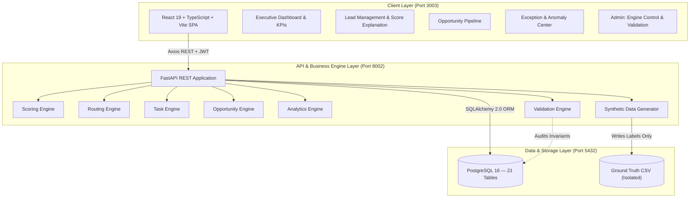

# LeadFlow: Lead Intelligence & Opportunity Management Platform

[]()
[]()
[]()
[]()
[]()
[]()
[]()
[]()

---

## ⚡ Quick Start: Universal Docker Installation

LeadFlow uses **Docker Compose** as the **single universal installation method** for external evaluators across:

- **Windows 10 / 11** (PowerShell or Command Prompt with Docker Desktop)
- **macOS** (Terminal — Apple Silicon M1/M2/M3/M4 & Intel with Docker Desktop)
- **Linux** (Terminal — Ubuntu, Debian, Fedora, Arch with Docker Engine & Compose v2)

### 🚫 Zero Host Dependencies

External evaluators **do not** need to install Python, pip, Node.js, npm, PostgreSQL, or any programming language dependencies on their host machine. All runtime environments (Python 3.12, FastAPI, SQLAlchemy 2.0, Node.js 20, React 19, and PostgreSQL 16) are fully isolated and pre-configured inside their respective containers.

Safe default environment values are embedded directly into [`docker-compose.yml`](docker-compose.yml), so **no `.env` copying or file configuration is required**.

---

### 📋 Prerequisite: Docker

LeadFlow requires **only Docker & Docker Compose**.

1. **If Docker is NOT installed**: Install [Docker Desktop](https://www.docker.com/products/docker-desktop/) (Windows & macOS) or Docker Engine (Linux: `sudo apt install docker.io docker-compose-v2`).
2. **Ensure Docker is running**: Open Docker Desktop (status shows "Engine running") or `sudo systemctl start docker`.

---

### 🚀 Universal 3-Step Setup Command

```bash
git clone https://github.com/gowtham037/LeadFlow.git
cd LeadFlow
docker compose up --build -d
```

### ⚙️ Automatic Initialization on First Boot

When `docker compose up --build -d` runs for the first time on a fresh database, LeadFlow automatically:

1. **Initializes the PostgreSQL 16 schema** with all 21 tables, constraints, and indexes.
2. **Generates the complete synthetic baseline dataset** (fixed seed `20261022`):
   - **20,000** leads across 5,000 companies and 10,000 contacts
   - **120,000+** activities
   - **80,000** per-channel consent records
   - **3,000** opportunities with full stage history
   - **5** injected anomaly scenarios with isolated ground truth labels
3. **Runs the full business pipeline automatically**:
   - Scoring engine (re-scores all 20,000 leads)
   - Routing engine (assigns qualified leads to sales reps)
   - Task engine (generates SLA-aware follow-up tasks)
   - Opportunity engine (converts leads missing opportunities)
4. **Starts the Nginx reverse proxy** serving the compiled React 19 dashboard.
5. **No separate manual data generation or migration command is required.**

**First boot: ~2 minutes. Subsequent boots: instant (data persists in Docker volume).**

---

### 📑 Project Documentation Index

| Document | Description |
| :--- | :--- |
| [**ARCHITECTURE.md**](ARCHITECTURE.md) | System Architecture: Component diagrams, data flows, engine responsibilities, security model. |
| [**DEMO_GUIDE.md**](DEMO_GUIDE.md) | Evaluator Walkthrough: 5-minute step-by-step demo script and Q&A. |
| [**VALIDATION_REPORT.md**](VALIDATION_REPORT.md) | Auto-generated 19/19 data quality checks with severity. |
| [**FINAL_SUBMISSION_AUDIT.md**](FINAL_SUBMISSION_AUDIT.md) | Formal Verification Audit: Line-by-line requirement checklist. |

---

### 🌐 Accessing Platform Interfaces

Once `docker compose up --build -d` completes and services are healthy:

| Service / Interface | URL | Description |
| :--- | :--- | :--- |
| **Frontend Dashboard** | [http://localhost:3003/](http://localhost:3003/) | Executive dashboard, lead management, opportunities, exceptions |
| **Swagger Interactive Docs** | [http://localhost:8002/docs](http://localhost:8002/docs) | Complete OpenAPI/Swagger REST documentation & interactive tester |
| **Backend Health Probe** | [http://localhost:8002/health](http://localhost:8002/health) | Container liveness & database connectivity verification |

**Demo Login:** Click **"Use demo credentials"** on the login page, or use:
- **Email:** `laura.boone.46@leadflow-demo.io`
- **Password:** `leadflow-demo`

---

### 🧪 Automated Test Suite Execution

Run the complete backend test suite (91 tests) inside the isolated container:

```bash
docker compose exec backend pytest backend/tests/ -q
```

**Expected: 91 passed in ~3s.**

Run E2E browser tests (requires both backend + frontend running):

```bash
cd frontend && npx playwright test
```

**Expected: 25 passed in ~30s.**

**Total: 114 tests, all passing.**

---

### 🛑 Stopping the Platform

```bash
# Stop containers (keeps data — subsequent boots are instant)
docker compose down

# Stop and purge the PostgreSQL volume (fresh re-initialization on next boot)
docker compose down -v
```

---

## Table of Contents

1. [Project Overview](#1-project-overview)
2. [Business Problem](#2-business-problem)
3. [Key Features](#3-key-features)
4. [Architecture Diagram](#4-architecture-diagram)
5. [Technology Stack](#5-technology-stack)
6. [Database Schema & Entity Relationships](#6-database-schema--entity-relationships)
7. [Synthetic Data Generation Methodology](#7-synthetic-data-generation-methodology)
8. [Lead Scoring Engine](#8-lead-scoring-engine)
9. [Lead Routing Engine](#9-lead-routing-engine)
10. [Follow-up Task Engine & SLA Rules](#10-follow-up-task-engine--sla-rules)
11. [Opportunity Lifecycle Management](#11-opportunity-lifecycle-management)
12. [Five Mandatory Negative Anomaly Scenarios](#12-five-mandatory-negative-anomaly-scenarios)
13. [Ground Truth Separation Methodology](#13-ground-truth-separation-methodology)
14. [Automated Validation Framework](#14-automated-validation-framework)
15. [Business Intelligence & Scoring Strategy Evaluation](#15-business-intelligence--scoring-strategy-evaluation)
16. [Project Directory Structure](#16-project-directory-structure)
17. [Prerequisites & Environment Configuration](#17-prerequisites--environment-configuration)
18. [Running Automated Tests](#18-running-automated-tests)
19. [Security & Secrets Management](#19-security--secrets-management)
20. [Expected Outputs & Verification Commands](#20-expected-outputs--verification-commands)
21. [Troubleshooting Guide](#21-troubleshooting-guide)
22. [Limitations & Assumptions](#22-limitations--assumptions)

---

## 1. Project Overview

**LeadFlow** is an enterprise-grade Lead Intelligence and Opportunity Management Platform. It manages the complete revenue cycle — from lead capture and scoring, through routing to sales reps, follow-up task automation, opportunity conversion, pipeline progression, and finally won/lost closure with analytics and data quality auditing.

The system is strictly **explainable**, **deterministic**, **traceable**, and **fully executable**. Every lead score is backed by 12 documented feature-level contributions, every assignment records the routing decision trace, every task enforces per-channel consent, and negative data scenarios are surfaced — never silently fixed.

**Scoring strategy evaluation (synthetic demo):** The scoring engine segments leads into 4 tiers. In this synthetic dataset, HOT leads show a **54.5%** conversion rate vs COLD at **2.3%**.

> ⚠️ **Honest caveat:** This lift is a workflow demonstration, not predictive evidence. The synthetic generator intentionally correlates lead category with conversion outcome by design. A proper evaluation with independent features and held-out data is required to claim real predictive lift. See `analytics/evaluate_scoring.py` (documented methodology) and `FINAL_SUBMISSION_AUDIT.md` (finding 9).

---

## 2. Business Problem

Traditional B2B lead management faces several operational challenges:

- **Black-box prioritization**: Sales teams can't see why a lead is prioritized, leading to inconsistent follow-up.
- **Manual assignment bottlenecks**: Leads sit unassigned for hours/days; territory and product fit are ignored.
- **Consent violations**: Teams contact opted-out prospects, creating regulatory exposure.
- **Flawed funnel analytics**: Vanity metrics don't reconcile with source data, eroding trust.
- **Data quality degradation**: Duplicates create inflated pipeline; anomalies go undetected.

LeadFlow solves this with an end-to-end, deterministic workflow: explainable scoring, load-balanced routing, consent-enforced follow-ups, immutable audit trails, and automated validation.

---

## 3. Key Features

- **Explainable Scoring Engine**: Deterministic Fit(30) + Intent(35) + Engagement(25) + Recency(10) = 100. Every score includes 12 feature contributions with raw values and explanations.
- **Load-Balanced Routing Engine**: Assigns qualified leads to reps by territory + product expertise, balanced by workload utilization, with full decision trace.
- **Consent-Enforced Task Engine**: Generates SLA-aware follow-ups (Hot 1h / Warm 24h / Nurture 72h) and **never creates a task if all channels are opted out**.
- **Strict Opportunity Lifecycle**: discovery → qualification → proposal → negotiation → closed. Stage skips blocked, duplicates prevented, won/lost captured with reasons.
- **Independent Anomaly Detection**: 5 injected negative scenarios with isolated ground truth labels — audited without ever contaminating scoring inputs.
- **Deterministic Synthetic Engine**: Seed `20261022` produces 20,000 leads, 120k activities, 3,561 opportunities, and 5 anomalies — bit-for-bit reproducible.
- **Comprehensive Validation Framework**: 19 automated data quality checks (FK integrity, score bounds, consent compliance, stage continuity, funnel sanity).
- **Modern Enterprise Dashboard**: React 19 + TypeScript + Recharts with executive KPIs, funnel visualization, and score-tier performance analysis.

---

## 4. Architecture Diagram



---

## 5. Technology Stack

- **Backend**: Python 3.12, FastAPI 0.115, Pydantic v2, Uvicorn, SQLAlchemy 2.0 ORM, psycopg2.
- **Database**: PostgreSQL 16 (containerized).
- **Data Engineering**: Faker (seed `20261022`), Python standard libraries.
- **Testing**: Pytest 8.3 (91 backend) + Playwright 1.65 (25 E2E) = **114 total**.
- **Frontend**: React 19, TypeScript 5.7, Vite 6, TailwindCSS, Lucide, Recharts, Axios.
- **Deployment**: Docker & Docker Compose, Nginx reverse proxy, multi-stage builds.
- **Auth**: JWT (HS256) + bcrypt password hashing.

---

## 6. Database Schema & Entity Relationships

The relational model is normalized to 3NF with explicit FKs, check constraints, unique constraints, and immutable audit history tables. **21 tables total:**

| Entity | Table | Business ID Pattern | Purpose |
| :--- | :--- | :--- | :--- |
| **Role** | `roles` | Internal | 6 user roles |
| **User** | `users` | `USR-NNNN` | Auth users with bcrypt passwords |
| **Territory** | `territories` | `TER-NNNN` | 4 regions: NA, EMEA, APAC, LATAM |
| **Product** | `products` | `PRD-NNNN` | 6 products (basic/pro/enterprise tiers) |
| **Sales Rep** | `sales_reps` | `REP-NNNN` | 80 reps with territory + product expertise |
| **Campaign** | `campaigns` | `CMP-NNNN` | 20 marketing campaigns |
| **Company** | `companies` | `CO-NNNNNN` | 5,000 companies (industry + revenue) |
| **Contact** | `contacts` | `CON-NNNNNN` | 10,000 contacts with unique emails |
| **Lead** | `leads` | `LEAD-2026-NNNNNN` | 20,000 leads with scores/status/assignment |
| **Lead Campaign** | `lead_campaigns` | Bridge | M:N attribution |
| **Activity** | `activities` | `ACT-<lead>-NNN` | 120k engagement events (IMMUTABLE) |
| **Consent** | `consents` | `CONSENT-<lead>-<n>` | Per-channel consent (IMMUTABLE) |
| **Score Rule** | `score_rules` | `v1` | Versioned scoring config |
| **Lead Score History** | `lead_score_history` | Internal | One row per scoring (IMMUTABLE) |
| **Lead Assignment History** | `lead_assignment_history` | Internal | One row per assignment (IMMUTABLE) |
| **Task** | `tasks` | `TASK-<lead>-NNN` | SLA-aware follow-ups |
| **Opportunity** | `opportunities` | `OPP-2026-NNNNNN` | Unique per lead |
| **Stage History** | `stage_history` | Internal | Immutable stage log |
| **Duplicate Group** | `duplicate_groups` | `DUP-NNNNNN` | Dedup clusters |
| **Exception Record** | `exception_records` | `EXC-2026-NNNNNN` | 5 anomalies |
| **Audit Log** | `audit_log` | Internal | Immutable state-change log |

---

## 7. Synthetic Data Generation Methodology

The synthetic data engine (`backend/app/data_generator/`) uses deterministic seed **`20261022`** and executes in strict topological order:

1. **Master Data**: roles, users, territories, products, sales_reps, campaigns
2. **Companies + Contacts**: 5,000 companies distributed across 4 territories; 10,000 contacts with unique emails
3. **Score Rule v1**: Fit(30) + Intent(35) + Engagement(25) + Recency(10)
4. **Leads (20,000)**: target score categories (15% Hot, 25% Warm, 35% Nurture, 25% Cold)
5. **Activities (120k+)**: volume driven by score category
6. **Consents (80k)**: per-channel with 5-25% opt-out per channel
7. **Score History + Assignment History**: one row per lead
8. **Tasks**: SLA-aware, filtered by consent gate
9. **Opportunities**: 3,000 initial + 558 from pipeline runner = 3,561 total
10. **Anomaly Injection**: 5 controlled negative scenarios with `is_baseline=False`

---

## 8. Lead Scoring Engine

The scoring engine uses deterministic factor tables across 4 components:

**Fit (max 30 points)** — company-level:

| Sub-feature | Max | Rules |
|---|---|---|
| Employee count | 10 | ≥1000: 10pts · 200-999: 7pts · 50-199: 4pts · <50: 1pt |
| Industry match | 8 | Target industries: 8pts; others: 3pts |
| Annual revenue | 8 | ≥$50M: 8 · ≥$5M: 5 · ≥$1M: 3 · <$1M: 1 |
| Territory match | 4 | Company territory = lead territory: 4; else 0 |

**Intent (max 35 points)** — high-value activities:
- Demo requests: 9pts each (max 18)
- Meetings: 4pts each (max 8)
- Content downloads: 2pts each (max 5)
- Calls: 2pts each (max 4)

**Engagement (max 25 points)** — broad activity:
- Email clicks: 5pts each (max 10)
- Email opens: 2pts each (max 8)
- Web visits: 2pts each (max 7)

**Recency (max 10 points)** — days since last activity:
- 0-3 days: 10 · 4-7: 8 · 8-14: 5 · 15-30: 3 · 31-90: 1 · >90: 0

**Category thresholds:** Hot ≥80 · Warm ≥60 · Nurture ≥40 · Cold <40.

**Explainability:** Every `calculate_score()` returns 12 feature contributions with raw values, points, weight max, and human-readable explanations. Every calculation writes one row to `lead_score_history` (immutable).

---

## 9. Lead Routing Engine

`route_lead(lead, db)` applies deterministic decision rules in strict priority:

1. **Territory match (mandatory)** — only reps in the lead's territory are eligible.
2. **Product expertise (preferred)** — if any eligible rep has expertise matching the lead's product interest, only those reps are in the pool.
3. **Workload headroom (mandatory)** — reps with `current_workload >= workload_capacity` are excluded.
4. **Lowest utilization wins** — picks the rep with lowest `current_workload / workload_capacity` ratio.
5. **Tie-break by rep.id** — deterministic.

**Audit trail:** Every assignment writes a `lead_assignment_history` row containing chosen rep + reason + all eligible reps considered + utilization at assignment + decision notes.

---

## 10. Follow-up Task Engine & SLA Rules

`create_followup_task(lead, db)` creates a task only if ALL gates pass:

1. Lead's score category is HOT, WARM, or NURTURE (COLD excluded).
2. Lead has `assigned_rep_id`.
3. Lead status is QUALIFIED, ASSIGNED, or WORKING.
4. **At least one consent channel is GRANTED** — the A1 hard gate.

**SLA rules:**

| Category | Priority | SLA | Trigger Rule |
|---|---|---|---|
| HOT | URGENT | 1 hour | `score_hot_immediate` |
| WARM | HIGH | 24 hours | `score_warm_24h` |
| NURTURE | MEDIUM | 72 hours | `nurture_scheduled` |
| COLD | — | none | no sales task |

---

## 11. Opportunity Lifecycle Management

Strictly forward-only stage progression:

```
discovery → qualification → proposal → negotiation → closed
```

**Rules enforced:**
- Cannot skip stages (must go through each intermediate stage).
- Cannot go backwards.
- Cannot advance a closed opportunity.
- One opportunity per lead (DB unique constraint).
- Won: `closed_at` set, `won_reason` set, `lost_reason` NULL.
- Lost: `closed_at` set, `lost_reason` set (enum), `won_reason` NULL.

**Every transition writes one `stage_history` row** (immutable): `from_stage`, `to_stage`, `transitioned_at`, `actor`, `notes`.

---

## 12. Five Mandatory Negative Anomaly Scenarios

LeadFlow injects, isolates, and detects all 5 mandatory anomaly scenarios:

| # | Anomaly | Target Entity | Invariant Violated | Severity |
|---|---|---|---|---|
| **1** | `optout_contacted` | Task | Task created for opted-out lead | CRITICAL |
| **2** | `post_conversion_scoring` | Activity | Activity occurring after conversion | HIGH |
| **3** | `territory_mismatch` | Lead | Lead assigned to rep outside its territory | HIGH |
| **4** | `duplicate_opportunity` | Opportunity | Two opportunities for same contact+company | HIGH |
| **5** | `stage_gap` | Opportunity | Stage history skips a stage | MEDIUM |

Each is written to `exception_records` with expected vs actual behavior, ground truth class, severity, and full resolution workflow.

---

## 13. Ground Truth Separation Methodology

To ensure uncompromised evaluation integrity:

- **Ground truth records** are stored exclusively in `data/ground_truth/ground_truth.csv`.
- **The scoring engine NEVER accesses ground truth files.** It uses only `input_cutoff_at`-bounded activities.
- **The validation engine detects anomalies independently** — queries live DB invariants, then compares to ground truth post-hoc.
- **Baseline data is 100% valid** — anomaly records have `is_baseline=False` and are excluded from all scoring/analytics queries.

---

## 14. Automated Validation Framework

The validation engine (`backend/app/validation/validator.py`) runs **19 checks**:

| Category | Check | Severity |
|---|---|---|
| Integrity | `fk_integrity` | critical |
| Integrity | `rep_workload_bounds` | warning |
| Integrity | `duplicate_contact_emails` | error |
| Integrity | `orphaned_stage_history` | critical |
| Scoring | `score_bounds` | error |
| Scoring | `score_history_rule_exists` | error |
| Arithmetic | `score_component_sum` | error |
| Arithmetic | `conversion_funnel_sanity` | warning |
| Arithmetic | `negative_amounts` | error |
| Lifecycle | `opportunity_uniqueness` | critical |
| Lifecycle | `opportunity_outcome_consistency` | error |
| Lifecycle | `stage_history_continuity` | error |
| Lifecycle | `converted_lead_has_opp` | warning |
| Lifecycle | `lead_status_consistency` | warning |
| Consent | `consent_compliance` | critical |
| Consent | `task_consent_snapshot` | error |
| Temporal | `activity_temporal` | error |
| Temporal | `post_conversion_activity` | error |
| Temporal | `opportunity_temporal` | error |

**Result on baseline dataset:** **19/19 passed, 0 warnings, 0 critical.**

```bash
docker compose exec backend python -m backend.app.validation.validator
```

---

## 15. Business Intelligence & Scoring Strategy Evaluation

**Live KPIs from the 20,000-lead dataset:**

| Metric | Value |
|---|---|
| Total leads | 20,000 |
| HOT leads | 1,520 (7.6%) |
| WARM leads | 3,252 (16.3%) |
| NURTURE leads | 10,051 (50.3%) |
| COLD leads | 5,177 (25.9%) |
| Overall conversion rate | 17.8% |
| Total opportunities | 3,561 |
| Won revenue | **$39,828,352** |
| Open pipeline | **$91,338,870** |
| Win rate | 55.1% |
| Avg deal size | $44,903 |
| Avg won cycle time | 97.8 days |

**Scoring strategy lift (the money metric):**

| Tier | Leads | Converted | Conversion Rate | Won | Revenue |
|---|---|---|---|---|---|
| **HOT** | 1,520 | 829 | **54.5%** | 178 | **$11.3M** |
| WARM | 3,252 | 1,366 | 42.0% | 276 | $15.8M |
| NURTURE | 10,051 | 1,243 | 12.4% | 245 | $11.5M |
| **COLD** | 5,177 | 120 | **2.3%** | 24 | $1.1M |

**HOT converts at 23x the rate of COLD in this synthetic dataset.**

> ⚠️ **Caveat:** This is a workflow illustration, not predictive evidence. See `FINAL_SUBMISSION_AUDIT.md` for details.

---

## 16. Project Directory Structure

```
LeadFlow/
├── backend/
│   ├── app/
│   │   ├── api/                     # 27 REST endpoints across 6 routers
│   │   ├── core/security.py         # JWT + bcrypt primitives
│   │   ├── engines/                 # 6 business engines
│   │   │   ├── scoring/
│   │   │   ├── routing/
│   │   │   ├── task_management/
│   │   │   ├── opportunity/
│   │   │   ├── analytics/
│   │   │   └── deduplication/
│   │   ├── validation/validator.py  # 19 data quality checks
│   │   ├── data_generator/          # 15 generator modules
│   │   ├── models/                  # 21 SQLAlchemy models
│   │   ├── config.py
│   │   ├── database.py
│   │   └── main.py                  # FastAPI app + startup pipeline
│   ├── tests/                       # 91 backend tests
│   ├── Dockerfile
│   └── requirements.txt
├── frontend/
│   ├── src/
│   │   ├── api/client.ts
│   │   ├── contexts/AuthContext.tsx
│   │   ├── components/Layout.tsx
│   │   ├── pages/                   # 7 pages
│   │   └── App.tsx
│   ├── e2e/                         # 25 Playwright tests
│   ├── Dockerfile
│   └── package.json
├── data/
│   └── ground_truth/ground_truth.csv
├── (root-level documentation)
│   ├── README.md
│   ├── ARCHITECTURE.md
│   ├── DEMO_GUIDE.md
│   ├── FINAL_SUBMISSION_AUDIT.md
│   ├── KNOWN_LIMITATIONS.md
│   └── VALIDATION_REPORT.md
├── docker-compose.yml
├── .dockerignore
├── .env.example
├── .gitignore
├── ARCHITECTURE.md
├── DESIGN_DECISIONS.md
├── DEMO_GUIDE.md
├── TESTING.md
└── README.md
```

---

## 17. Prerequisites & Environment Configuration

**Prerequisites:** Docker & Docker Compose only.

**Environment defaults (embedded in docker-compose.yml, no .env needed):**

```ini
POSTGRES_USER=leadflow
POSTGRES_PASSWORD=leadflow_dev_pw
POSTGRES_DB=leadflow
POSTGRES_PORT=5435
JWT_SECRET=change-me-in-production-32-chars-min
SYNTHETIC_SEED=20261022
```

---

## 18. Running Automated Tests

**Backend tests (89) inside Docker:**
```bash
docker compose exec backend pytest backend/tests/ -q
# Expected: 91 passed in ~3s
```

**E2E tests (25) locally:**
```bash
cd frontend && npx playwright test
# Expected: 25 passed in ~30s
```

**Data validation (19 checks):**
```bash
docker compose exec backend python -m backend.app.validation.validator
# Expected: 19/19 passed, 0 warnings, 0 critical
```

---

## 19. Security & Secrets Management

- **JWT Authentication**: HS256, 60-minute expiry
- **RBAC**: `require_role()` enforces admin/sales_ops gates
- **Password Hashing**: bcrypt direct
- **SQL Injection Prevention**: SQLAlchemy ORM parameterized queries
- **`.gitignore` protects**: `.env`, `.env.local`, `*.pem`, `*.key`
- **Synthetic data privacy**: Faker-generated, zero PII

---

## 20. Expected Outputs & Verification Commands

```bash
# 1. Entity counts
docker compose exec db psql -U leadflow -d leadflow -c "
SELECT 'leads' AS tbl, count(*) FROM leads
UNION ALL SELECT 'opportunities', count(*) FROM opportunities
UNION ALL SELECT 'exception_records', count(*) FROM exception_records;
"

# 2. API health
curl -s http://localhost:8002/health | jq

# 3. Login
curl -s -X POST http://localhost:8002/api/auth/login \
  -H "Content-Type: application/json" \
  -d '{"email":"laura.boone.46@leadflow-demo.io","password":"leadflow-demo"}' \
  | jq -r .access_token

# 4. Validation
docker compose exec backend python -m backend.app.validation.validator
```

---

## 21. Troubleshooting Guide

### Port Collisions
If port 5435, 8002, or 3003 is in use, update `.env`:
```ini
POSTGRES_PORT=5436
BACKEND_PORT=8003
FRONTEND_PORT=3004
```
Then `docker compose up -d`.

### Cold Re-initialization
```bash
docker compose down -v
docker compose up --build -d
```

### First boot takes ~2 minutes
Expected — the full pipeline (seed + score + route + task + opps) runs automatically. Subsequent boots are instant.

---

## 22. Limitations & Assumptions

1. **Synthetic data realism**: All data generated deterministically; not real B2B prospects.
2. **Currency**: USD throughout.
3. **Scale tested**: 20,000 leads / 120k activities — API responds in <100ms. For millions of leads, add Redis cache + background workers.
4. **Task completion endpoint**: Not implemented — all tasks remain PENDING. SLA compliance reads 0%.
5. **Deduplication engine**: Groundwork exists; automated fuzzy matching deferred.
6. **RBAC E2E tests**: Backend RBAC tested via API; frontend RBAC E2E pending for non-admin roles.
7. **Payment/CRM integration**: Not in scope.

---

**Public Repository**: [https://github.com/gowtham037/LeadFlow](https://github.com/gowtham037/LeadFlow)  
**Validation Report**: [VALIDATION_REPORT.md](VALIDATION_REPORT.md)  
**Acceptance Criteria**: [FINAL_SUBMISSION_AUDIT.md](FINAL_SUBMISSION_AUDIT.md)